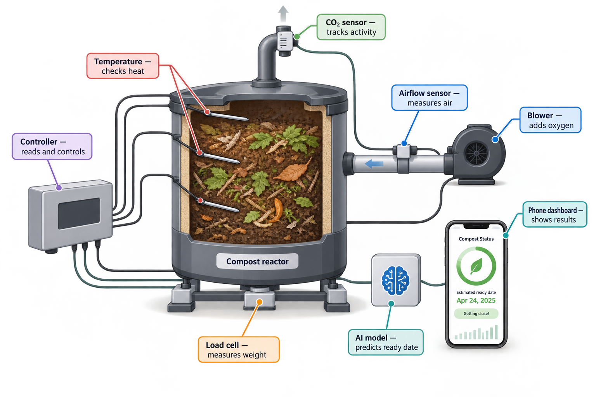

# Smart Compost MVP

A small compost-monitoring prototype that records temperature, CO2, and weight, then adjusts airflow through a blower and motorized damper. An AI agent can recommend or request airflow changes, while fixed safety rules remain in control.



## MVP goal

Prove that a low-cost sensor system can:

1. Monitor a 20–50 L compost batch.
2. Control airflow using temperature and CO2 trends.
3. Log every reading and control decision.
4. Collect clean data for a later compost-maturity prediction model.

## Current status

- Product idea and technical scope defined.
- Main components and build order defined.
- System illustration completed.
- No hardware has been assembled yet.
- No firmware, dashboard, AI controller, or dataset exists yet.

See [STATUS.md](STATUS.md) for the handover and immediate next steps.

## Repository structure

```text
docs/
  architecture.md       System design and control logic
  build-plan.md         Step-by-step implementation plan
  bill-of-materials.md  Shopping list
  assets/               System illustration
research/
  compost-handover.html Original research handover
firmware/               ESP32 code (to be added)
software/               Dashboard, database, and AI controller (to be added)
data/                    Sample schemas; experiment data stays ignored
```

## Safety design

The AI does not directly bypass the controller. It requests `OPEN`, `CLOSE`, or `PARTIAL` airflow. The ESP32 checks hard temperature limits, sensor health, minimum ventilation, and maximum switching frequency before acting. A manual switch remains available.

## First milestone

Build and calibrate the sensors on a bench, then log stable readings for 24 hours before adding compost or enabling automatic control.
