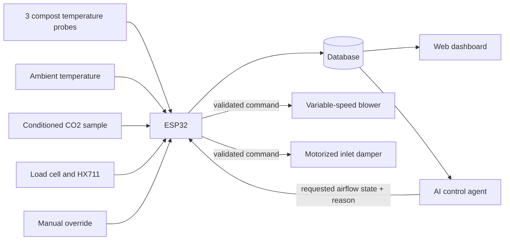

# MVP architecture

## Data and control flow



## Required measurements

- Three internal temperatures: top, middle, and bottom.
- Ambient temperature.
- CO2 in a cooled, filtered, non-condensing exhaust sample.
- Total vessel weight.
- Blower command and damper position.
- Batch age and operator actions.

## AI command contract

The AI receives current readings, recent trends, control history, and configured limits. It returns:

```json
{
  "airflow": "OPEN | PARTIAL | CLOSED",
  "blower_percent": 0,
  "reason": "short explanation",
  "valid_for_seconds": 300
}
```

The ESP32 rejects malformed, expired, too-frequent, or unsafe commands.

## Controller fallback

- Excessive temperature or CO2: force higher airflow and raise an alert.
- Failed sensor: use conservative fixed ventilation and raise an alert.
- Lost Wi-Fi or AI service: continue local rule-based control.
- Manual override: operator directly selects a safe airflow mode.
- Exhaust: always open; never seal an active compost vessel.

Exact thresholds must be chosen during calibration and testing for the selected vessel and feedstock.

